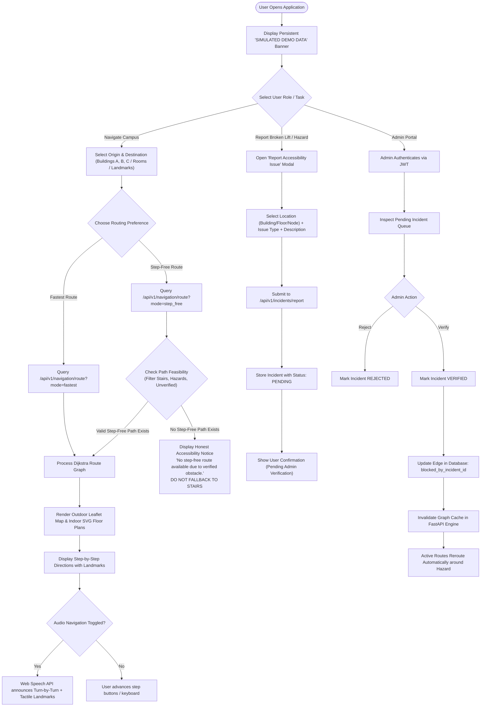
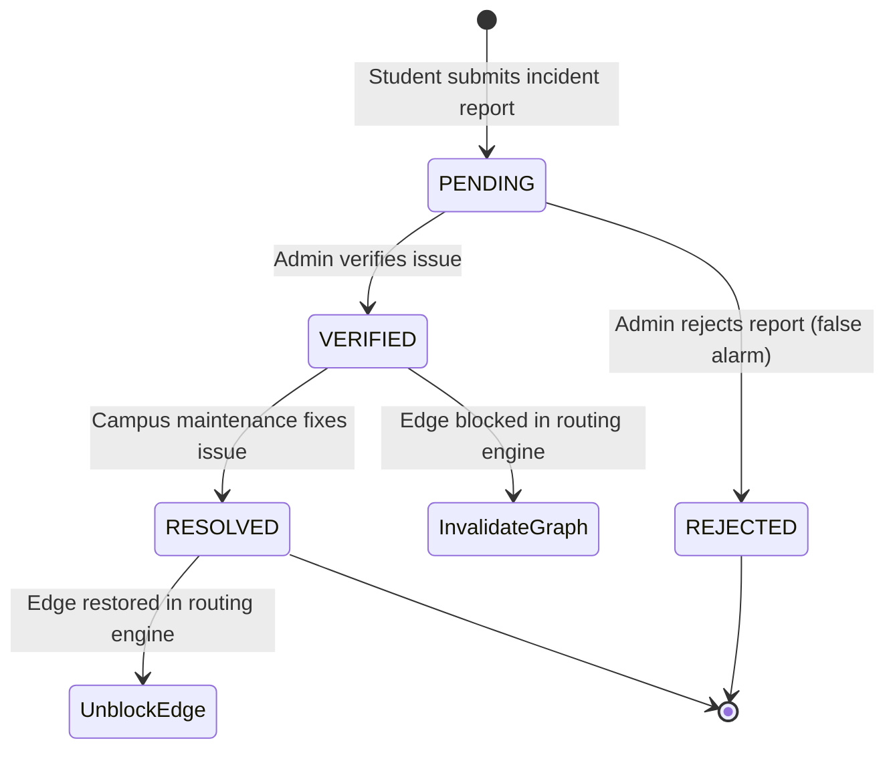

# ACCESSWAY AI — Application Flow & State Management

**Project:** ACCESSWAY AI — Accessible Campus Navigator  
**Document:** Application Flow, User Experience Sequences, and State Transitions  
**Version:** 1.0.0  

---

## 1. High-Level Mermaid Application Flow

---

## 2. Core Application Modules

### Module 1: Persistent Shell & Accessibility Toolbar (`/`)
- **Components:**
  - Header with Logo, Tagline (*Every Path Should Be Accessible*), and "SIMULATED DEMO DATA" warning pill.
  - Accessibility Controller (Font size scaling, High Contrast mode toggle, Voice navigation speed setting).
  - Navigation Landmark Links (Skip to Main Content, Skip to Navigation, Skip to Incident Reporter).

### Module 2: Route Planner & Form Module
- **Components:**
  - `OriginSelect` and `DestinationSelect` inputs with searchable autocomplete, grouped by Building (Building A, Building B, Building C, Outdoor Plazas).
  - Mode Switcher:
    - **Step-Free Route** (Selected by default for maximum accessibility safety).
    - **Fastest Route** (Includes stairs and escalators).
  - Quick filters: Accessible Restrooms, Elevator-only entry, Tactile paving paths.

### Module 3: Dual-Mode Interactive Campus Map
- **Components:**
  - **Outdoor Campus Map:** Leaflet map with custom accessibility tiles, custom high-visibility SVG pin markers, and color-coded path polylines.
  - **Indoor Floor Plan Viewer:** Scalable Vector Graphics (SVG) floor plans for Building A, B, and C with multi-floor selector (Ground, Floor 1, Floor 2).
  - **Synchronized Viewport:** Automatically pans/zooms when stepping between outdoor walkways and indoor floor plans.
  - **Hazard Pins:** Pulsing amber/red caution badges on nodes with verified reported obstacles.

### Module 4: Turn-by-Turn Guidance & Audio Synthesizer
- **Components:**
  - Step card list: Displays step number, direction icon (Turn left, Straight, Take lift), distance, and landmark cue.
  - Screen Reader Live Region (`aria-live="polite"`).
  - Audio Player Bar: Spoken guidance controls (`Play`, `Pause`, `Repeat Step`, `Next Step`, `Volume`, `Rate`).

### Module 5: Crowdsourced Hazard Reporter
- **Components:**
  - Public reporting modal accessible from any screen via `Alt+R` or header button.
  - Form fields: Building selector, Floor selector, Amenity/Node picker, Issue type (*Broken Lift*, *Blocked Ramp*, *Slippery Surface*, *Stairs without Handrail*, *Automatic Door Malfunction*), Details text area.
  - Instant submission feedback state with report ticket ID.

### Module 6: Admin Verification & Hazard Management Console (`/admin`)
- **Components:**
  - Secure JWT-based Login.
  - Tabular Incident Dashboard: Columns for Timestamp, Reporter, Building/Location, Issue Type, Status badge (`PENDING`, `VERIFIED`, `RESOLVED`, `REJECTED`), Actions.
  - Action buttons: "Verify Issue", "Mark Resolved", "Reject Report".
  - Live Graph State Monitor: Visualizes currently blocked edges and their impact on campus routes.
  - Synthetic Data Template Manager: Export template JSON or import survey GeoJSON.

---

## 3. Detailed State Transitions

### 3.1 Route Finder State Machine

| State | Trigger | Next State | Actions & UI Rendering |
| :--- | :--- | :--- | :--- |
| `IDLE` | Page Load | `IDLE` | Render default campus map; clear active route; show search prompt. |
| `SELECTING` | User selects origin/dest | `SELECTING` | Validate origin $\neq$ destination; enable "Find Route" CTA. |
| `COMPUTING` | Click "Find Route" / Form submit | `ROUTE_FOUND` or `NO_ROUTE_AVAILABLE` or `ERROR` | Show animated accessible loading spinner; announce "Calculating accessible route..." to screen readers. |
| `ROUTE_FOUND` | API 200 with path | `NAVIGATING` | Render polyline on map; load initial step; initialize Speech Synthesis queue. |
| `NO_ROUTE_AVAILABLE` | API 200 with `found: false` | `IDLE` | Display prominent warning banner: *"No step-free route exists between these locations. Lift L1 in Building B is currently out of service."* Announce to ARIA live. |
| `ERROR` | API 500 / Network drop | `IDLE` | Show error alert with retry button: *"Unable to connect to routing service. Please verify your connection."* |

### 3.2 Spoken Audio Navigation State Machine

| State | Trigger | Next State | Action |
| :--- | :--- | :--- | :--- |
| `AUDIO_MUTED` | Initial Load / Mute toggle | `AUDIO_MUTED` | Speech synthesis queue stopped; icons indicate muted. |
| `AUDIO_ACTIVE` | User clicks "Start Audio Guidance" | `SPEAKING_STEP` | Synthesize Step 1 text; trigger `window.speechSynthesis.speak()`. |
| `SPEAKING_STEP` | Audio ends | `IDLE_WAITING_STEP` | Wait for user to click "Next Step" or auto-advance. |
| `HAZARD_INTERRUPT` | Active route affected by newly verified hazard | `SPEAKING_ALERT` | `speechSynthesis.cancel()`; immediately announce urgent reroute notification. |

### 3.3 Incident Lifecycle State Machine

---

## 4. Error, Loading, and Empty States Checklist

1. **Loading State:**
   - Skeleton loaders for route steps.
   - Screen-reader friendly aria announcements: `"Loading campus route, please wait..."`
   - Map loading placeholder tiles with fallback canvas.
2. **Error State:**
   - Network failure message with clear "Retry" action.
   - Backend validation errors rendered inline next to form fields.
   - Fail-safe fallbacks: Never crash into blank white screen.
3. **Empty State:**
   - No origin/destination selected: Helpful prompt with popular quick-start presets (*"Building A West Entrance to Library"*).
   - Admin queue empty: *"No pending accessibility reports. All campus facilities verified operational."*
4. **Honest Accessibility Failure State:**
   - Distinct from a network error. Prominently explains why no route could be found (e.g. lift broken, no ramps exist on upper floor) without offering stairs as an unprompted fallback.
