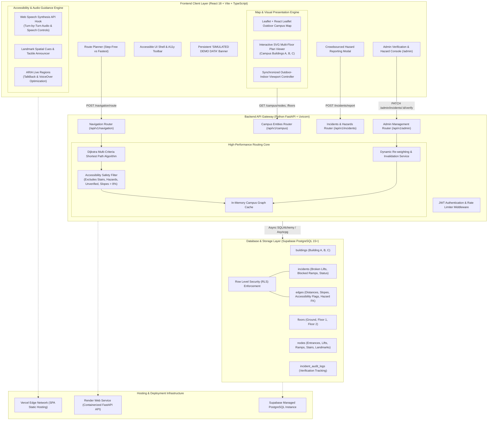

# ACCESSWAY AI — System Architecture

**Project:** ACCESSWAY AI — Accessible Campus Navigator  
**Tagline:** *Every Path Should Be Accessible.*  
**Hackathon:** Code Fuzion 2026 — Problem Statement M9  
**Document:** End-to-End System Architecture, Component Topologies, and Data Flow  
**Version:** 1.0.0  

---

## 1. System Architecture Diagram



---

## 2. Component Deconstruction

### 2.1 Client Presentation Layer (Vercel)
- **Framework:** React 18 with Vite and TypeScript.
- **Styling:** Tailwind CSS with custom high-contrast color extensions and accessible interactive focus outlines.
- **Outdoor Mapping:** Leaflet with tile layers and GeoJSON polyline overlays for campus walkways, pedestrian paths, and exterior ramps.
- **Indoor Mapping:** Precision SVG maps rendered inline with responsive viewports, supporting floor-level switching (Ground, Floor 1, Floor 2) for Campus Buildings A, B, and C.
- **Voice Guidance:** Native browser `window.speechSynthesis` wrapper with auto-queueing, playback speed modulation, pause/resume, and screen-reader announcements.
- **Accessibility:** Strict WCAG 2.1 AA/AAA conformance, TalkBack (Android) and VoiceOver (iOS/macOS) compatible ARIA roles, landmarks, and live status announcers.

### 2.2 Routing Engine & Backend Service (Render)
- **Framework:** Python 3.10+ with FastAPI.
- **In-Memory Graph Cache:** At application boot, the full campus graph \( G = (V, E) \) is loaded into memory as an adjacency list.
- **Dijkstra Algorithm:**
  - Standard edge weights based on metric distance.
  - Multi-criteria pruning: When `mode == "step_free"`, the graph traversal dynamically eliminates edges where `is_stairs == True`, `blocked_by_incident_id != None`, `verified_accessible == False`, or `slope_percentage > 8.33%`.
  - Fail-safe response: If no path connects origin to destination under step-free constraints, the API returns a structured HTTP 200 with `route_found: false` and `reason: "No step-free route available"`. It **never** falls back to stairs.
- **Dynamic Re-weighting:** Upon admin verification of an incident, the backend triggers immediate edge invalidation in `GraphCache`.

### 2.3 Database Layer (Supabase PostgreSQL)
- **Engine:** PostgreSQL 15+ hosted on Supabase.
- **Relational Integrity:** Foreign keys link edges to nodes, floors to buildings, and incidents to affected nodes/edges.
- **Row Level Security (RLS):**
  - Anonymous users can read building, floor, node, edge, and verified incident records.
  - Anonymous users can insert incident reports with `status = 'PENDING'`.
  - Only authenticated admin users (or the backend service role) can verify, resolve, or reject incidents and update edge accessibility statuses.
- **Audit Logging:** Every status change is recorded in `incident_audit_logs` for accountability.

---

## 3. Indoor-Outdoor Campus Graph Modeling

The campus graph bridges outdoor grounds and indoor building layouts seamlessly:

```mermaid
graph LR
    subgraph OutdoorPlaza ["Outdoor Campus Grounds"]
        N_PLAZA["Outdoor Central Plaza (WGS84 Lat/Lng)"]
    end

    subgraph BuildingA ["Campus Building A (Ground Floor)"]
        N_BLDGA_ENTRANCE["Building A West Entrance (Threshold Node)"]
        N_BLDGA_HALL["Ground Floor Main Hallway"]
        N_BLDGA_LIFT_G["Building A Elevator (Ground)"]
        N_BLDGA_STAIRS_G["Building A Stairs (Ground)"]
    end

    subgraph BuildingA_Floor1 ["Campus Building A (Floor 1)"]
        N_BLDGA_LIFT_F1["Building A Elevator (Floor 1)"]
        N_BLDGA_STAIRS_F1["Building A Stairs (Floor 1)"]
        N_BLDGA_ROOM101["Classroom 101"]
    end

    %% Connectors
    N_PLAZA <== "Outdoor Walkway (Paved, 45m)" ==> N_BLDGA_ENTRANCE
    N_BLDGA_ENTRANCE <== "Level Corridor (12m)" ==> N_BLDGA_HALL
    N_BLDGA_HALL <== "Level Corridor (15m)" ==> N_BLDGA_LIFT_G
    N_BLDGA_HALL <== "Level Corridor (10m)" ==> N_BLDGA_STAIRS_G
    
    %% Vertical Transit
    N_BLDGA_LIFT_G <== "Step-Free Elevator Transit" ==> N_BLDGA_LIFT_F1
    N_BLDGA_STAIRS_G -.->|"Stairs (Excluded in Step-Free)"| N_BLDGA_STAIRS_F1
    
    N_BLDGA_LIFT_F1 <== "Level Corridor (8m)" ==> N_BLDGA_ROOM101
    N_BLDGA_STAIRS_F1 -.-> N_BLDGA_ROOM101
```



- **Threshold Nodes:** Building entrances act as coordinate bridges containing both outdoor GPS coordinates (`lat`, `lng`) and indoor SVG planar coordinates (`svg_x`, `svg_y`).
- **Vertical Connectors:** Lifts and staircases link nodes on different floor numbers (`floor_number = 0, 1, 2`) with explicit metadata tags.

---

## 4. Security & Environment Configuration

### 4.1 Secrets Isolation
```text
+------------------------------+---------------------------------------+
| Environment                  | Allowed Secrets                       |
+------------------------------+---------------------------------------+
| Frontend (.env)              | VITE_API_URL                          |
|                              | VITE_SUPABASE_URL                     |
|                              | VITE_SUPABASE_ANON_KEY (Public Only)  |
+------------------------------+---------------------------------------+
| Backend (.env)               | SUPABASE_URL                          |
|                              | SUPABASE_SERVICE_ROLE_KEY (Secret)    |
|                              | DATABASE_URL                          |
|                              | JWT_SECRET_KEY                        |
|                              | ADMIN_PASSWORD_HASH                   |
+------------------------------+---------------------------------------+
```

### 4.2 Fail-Safe Principles
1. **Never Fallback to Stairs:** In step-free mode, under zero circumstances can an edge with `is_stairs == True` be traversed.
2. **Never Treat Unknown as Accessible:** Any path without explicit verified accessibility attributes (`verified_accessible == True`) is pruned.
3. **Synthetic Notice:** The application enforces the simulated demo notice banner on all public and administrative interfaces.
