# ACCESSWAY AI — Database Architecture & Schema Design

**Project:** ACCESSWAY AI — Accessible Campus Navigator  
**Database Engine:** Supabase PostgreSQL 15+  
**Document:** Entity-Relationship Modeling, DDL, Security Policies (RLS), and Indexing  
**Version:** 1.0.0  

---

## 1. Entity-Relationship (ER) Overview

```mermaid
erDiagram
    BUILDINGS ||--o{ FLOORS : contains
    BUILDINGS ||--o{ NODES : encompasses
    FLOORS ||--o{ NODES : locates
    NODES ||--o{ EDGES : "source_node"
    NODES ||--o{ EDGES : "target_node"
    NODES ||--o{ INCIDENTS : "reported_at_node"
    EDGES ||--o{ INCIDENTS : "blocks_edge"
    INCIDENTS ||--o{ INCIDENT_AUDIT_LOGS : tracks

    BUILDINGS {
        uuid id PK
        string name
        string code
        string description
        float center_lat
        float center_lng
        timestamp created_at
    }

    FLOORS {
        uuid id PK
        uuid building_id FK
        int floor_number
        string floor_name
        string svg_asset_path
        jsonb bounds_json
        timestamp created_at
    }

    NODES {
        uuid id PK
        uuid building_id FK
        uuid floor_id FK
        int floor_number
        string name
        string code
        string node_type
        boolean is_landmark
        text landmark_description
        boolean tactile_paving
        float lat
        float lng
        float svg_x
        float svg_y
        timestamp created_at
    }

    EDGES {
        uuid id PK
        uuid source_node_id FK
        uuid target_node_id FK
        float distance_meters
        string edge_type
        float slope_percentage
        float width_meters
        boolean is_stairs
        boolean is_lift
        boolean is_ramp
        string surface_type
        boolean verified_accessible
        uuid blocked_by_incident_id FK
        text direction_cue
        text landmark_cue
        timestamp created_at
    }

    INCIDENTS {
        uuid id PK
        uuid node_id FK
        uuid edge_id FK
        uuid building_id FK
        int floor_number
        string category
        string title
        text description
        string status
        string reported_by
        string verified_by
        timestamp verified_at
        timestamp created_at
        timestamp updated_at
    }

    INCIDENT_AUDIT_LOGS {
        uuid id PK
        uuid incident_id FK
        string previous_status
        string new_status
        string changed_by
        text notes
        timestamp created_at
    }
```



---

## 2. Table Definitions & DDL Specifications

```sql
-- Enable UUID extension
CREATE EXTENSION IF NOT EXISTS "uuid-ossp";

-- 1. BUILDINGS TABLE
CREATE TABLE public.buildings (
    id UUID PRIMARY KEY DEFAULT uuid_generate_v4(),
    name VARCHAR(100) NOT NULL,              -- e.g. "Campus Building A"
    code VARCHAR(20) UNIQUE NOT NULL,         -- e.g. "BLDG_A"
    description TEXT,
    center_lat DOUBLE PRECISION NOT NULL,
    center_lng DOUBLE PRECISION NOT NULL,
    created_at TIMESTAMPTZ NOT NULL DEFAULT NOW()
);

-- 2. FLOORS TABLE
CREATE TABLE public.floors (
    id UUID PRIMARY KEY DEFAULT uuid_generate_v4(),
    building_id UUID NOT NULL REFERENCES public.buildings(id) ON DELETE CASCADE,
    floor_number INT NOT NULL,               -- 0 = Ground, 1 = Floor 1, 2 = Floor 2
    floor_name VARCHAR(50) NOT NULL,         -- e.g. "Ground Floor"
    svg_asset_path VARCHAR(255) NOT NULL,
    bounds_json JSONB DEFAULT '{}'::jsonb,
    created_at TIMESTAMPTZ NOT NULL DEFAULT NOW(),
    UNIQUE (building_id, floor_number)
);

-- 3. NODES TABLE (Campus Waypoints & Landmarks)
CREATE TABLE public.nodes (
    id UUID PRIMARY KEY DEFAULT uuid_generate_v4(),
    building_id UUID REFERENCES public.buildings(id) ON DELETE SET NULL,
    floor_id UUID REFERENCES public.floors(id) ON DELETE SET NULL,
    floor_number INT DEFAULT 0,
    name VARCHAR(150) NOT NULL,              -- e.g. "Building A West Entrance"
    code VARCHAR(50) UNIQUE NOT NULL,        -- e.g. "NODE_BLDGA_ENTRANCE_W"
    node_type VARCHAR(30) NOT NULL CHECK (
        node_type IN ('entrance', 'room', 'lift', 'stairs', 'ramp', 'junction', 'landmark', 'restroom')
    ),
    is_landmark BOOLEAN NOT NULL DEFAULT FALSE,
    landmark_description TEXT,
    tactile_paving BOOLEAN NOT NULL DEFAULT FALSE,
    lat DOUBLE PRECISION,                    -- Outdoor WGS84 coordinates
    lng DOUBLE PRECISION,
    svg_x DOUBLE PRECISION,                  -- Indoor floor SVG coordinate X
    svg_y DOUBLE PRECISION,                  -- Indoor floor SVG coordinate Y
    created_at TIMESTAMPTZ NOT NULL DEFAULT NOW()
);

-- 4. EDGES TABLE (Paths & Transitions)
CREATE TABLE public.edges (
    id UUID PRIMARY KEY DEFAULT uuid_generate_v4(),
    source_node_id UUID NOT NULL REFERENCES public.nodes(id) ON DELETE CASCADE,
    target_node_id UUID NOT NULL REFERENCES public.nodes(id) ON DELETE CASCADE,
    distance_meters DOUBLE PRECISION NOT NULL CHECK (distance_meters > 0),
    edge_type VARCHAR(30) NOT NULL CHECK (
        edge_type IN ('corridor', 'outdoor_path', 'ramp', 'lift', 'stairs', 'door')
    ),
    slope_percentage DOUBLE PRECISION NOT NULL DEFAULT 0.0,
    width_meters DOUBLE PRECISION NOT NULL DEFAULT 1.2,
    is_stairs BOOLEAN NOT NULL DEFAULT FALSE,
    is_lift BOOLEAN NOT NULL DEFAULT FALSE,
    is_ramp BOOLEAN NOT NULL DEFAULT FALSE,
    surface_type VARCHAR(30) NOT NULL CHECK (
        surface_type IN ('smooth_tile', 'paved_concrete', 'asphalt', 'cobblestone', 'gravel')
    ),
    verified_accessible BOOLEAN NOT NULL DEFAULT FALSE,
    blocked_by_incident_id UUID,             -- FK added below to avoid circular dependency
    direction_cue TEXT NOT NULL,
    landmark_cue TEXT,
    created_at TIMESTAMPTZ NOT NULL DEFAULT NOW()
);

-- 5. INCIDENTS TABLE (Accessibility Hazard Reports)
CREATE TABLE public.incidents (
    id UUID PRIMARY KEY DEFAULT uuid_generate_v4(),
    node_id UUID REFERENCES public.nodes(id) ON DELETE SET NULL,
    edge_id UUID REFERENCES public.edges(id) ON DELETE SET NULL,
    building_id UUID REFERENCES public.buildings(id) ON DELETE SET NULL,
    floor_number INT,
    category VARCHAR(50) NOT NULL CHECK (
        category IN ('broken_lift', 'blocked_ramp', 'slippery_surface', 'construction_obstacle', 'door_inaccessible', 'other')
    ),
    title VARCHAR(150) NOT NULL,
    description TEXT NOT NULL,
    status VARCHAR(20) NOT NULL DEFAULT 'PENDING' CHECK (
        status IN ('PENDING', 'VERIFIED', 'RESOLVED', 'REJECTED')
    ),
    reported_by VARCHAR(100) DEFAULT 'Anonymous Student',
    verified_by VARCHAR(100),
    verified_at TIMESTAMPTZ,
    created_at TIMESTAMPTZ NOT NULL DEFAULT NOW(),
    updated_at TIMESTAMPTZ NOT NULL DEFAULT NOW()
);

-- Add foreign key constraint for blocked_by_incident_id
ALTER TABLE public.edges
ADD CONSTRAINT fk_edges_blocked_incident
FOREIGN KEY (blocked_by_incident_id) REFERENCES public.incidents(id) ON DELETE SET NULL;

-- 6. INCIDENT AUDIT LOGS TABLE
CREATE TABLE public.incident_audit_logs (
    id UUID PRIMARY KEY DEFAULT uuid_generate_v4(),
    incident_id UUID NOT NULL REFERENCES public.incidents(id) ON DELETE CASCADE,
    previous_status VARCHAR(20) NOT NULL,
    new_status VARCHAR(20) NOT NULL,
    changed_by VARCHAR(100) NOT NULL,
    notes TEXT,
    created_at TIMESTAMPTZ NOT NULL DEFAULT NOW()
);
```

---

## 3. Database Indexes for Query Optimization

```sql
-- Indexes for rapid pathfinding graph loads
CREATE INDEX idx_edges_source_target ON public.edges(source_node_id, target_node_id);
CREATE INDEX idx_edges_accessible_status ON public.edges(verified_accessible, is_stairs, blocked_by_incident_id);
CREATE INDEX idx_nodes_building_floor ON public.nodes(building_id, floor_number);
CREATE INDEX idx_nodes_is_landmark ON public.nodes(is_landmark) WHERE is_landmark IS TRUE;

-- Indexes for active incident queries
CREATE INDEX idx_incidents_status ON public.incidents(status);
CREATE INDEX idx_incidents_node_edge ON public.incidents(node_id, edge_id);
CREATE INDEX idx_audit_incident ON public.incident_audit_logs(incident_id);
```

---

## 4. Row Level Security (RLS) Policies

All tables have RLS enabled to safeguard data integrity and ensure public users cannot tamper with verified accessibility weights.

```sql
-- Enable RLS across all tables
ALTER TABLE public.buildings ENABLE ROW LEVEL SECURITY;
ALTER TABLE public.floors ENABLE ROW LEVEL SECURITY;
ALTER TABLE public.nodes ENABLE ROW LEVEL SECURITY;
ALTER TABLE public.edges ENABLE ROW LEVEL SECURITY;
ALTER TABLE public.incidents ENABLE ROW LEVEL SECURITY;
ALTER TABLE public.incident_audit_logs ENABLE ROW LEVEL SECURITY;

-- 1. BUILDINGS, FLOORS, NODES, EDGES: Public can read, only Service Role / Admin can write
CREATE POLICY "Public can view buildings" ON public.buildings FOR SELECT USING (true);
CREATE POLICY "Public can view floors" ON public.floors FOR SELECT USING (true);
CREATE POLICY "Public can view nodes" ON public.nodes FOR SELECT USING (true);
CREATE POLICY "Public can view edges" ON public.edges FOR SELECT USING (true);

-- 2. INCIDENTS:
-- Public can view VERIFIED and RESOLVED incidents (to see why paths are blocked)
CREATE POLICY "Public can view verified incidents" ON public.incidents
FOR SELECT USING (status IN ('VERIFIED', 'RESOLVED'));

-- Public can submit new incidents with default status 'PENDING'
CREATE POLICY "Public can submit pending incidents" ON public.incidents
FOR INSERT WITH CHECK (status = 'PENDING');

-- Admins / Service role can perform full CRUD on incidents
CREATE POLICY "Admin full access on incidents" ON public.incidents
FOR ALL USING (auth.role() = 'service_role' OR auth.jwt() ->> 'role' = 'admin');

-- 3. AUDIT LOGS:
-- Only admins can read audit logs
CREATE POLICY "Admin read audit logs" ON public.incident_audit_logs
FOR SELECT USING (auth.role() = 'service_role' OR auth.jwt() ->> 'role' = 'admin');
```

---

## 5. Synthetic Demonstration Dataset Seed Design

To honor the project's data safety rules, the database is seeded strictly with placeholder entities:
- **Buildings:**
  - `Campus Building A` (Code: `BLDG_A`, Academic & Administrative Block)
  - `Campus Building B` (Code: `BLDG_B`, Science & Engineering Block)
  - `Campus Building C` (Code: `BLDG_C`, Student Center & Central Library)
- **Waypoints & Interconnections:**
  - Outdoor paved plaza connecting Building A East Entrance to Building B West Entrance.
  - Accessible Ramp interconnecting Building B Ground Floor to Building C South Walkway.
  - Dual vertical transit in each building: 1 Lift and 1 Staircase per building across Ground, Floor 1, and Floor 2.
- **Pre-configured Test Incident:**
  - Lift L1 in Building B has a simulated test incident that can be verified in real time to showcase dynamic rerouting via the exterior accessible ramp.
